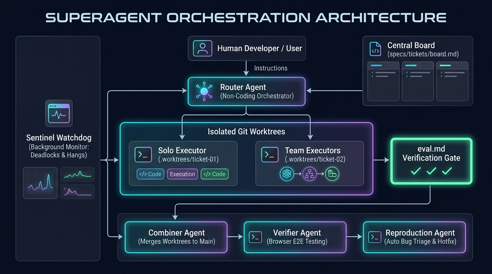

# Superagent Multi-Agent Orchestration

An autonomous multi-agent engineering workflow designed to eliminate context degradation and coordination bottlenecks during complex software development.



---

## Overview

Traditional AI coding workflows often overload a single agent session with simultaneous high-level planning, code synthesis, bug-fixing, and user communication. This leads to rapid context window exhaustion and frequent task interruptions.

The **Superagent Orchestration** architecture decouples these responsibilities across specialized agent roles and isolated workspaces:

* **Router Agent (Non-Coding Orchestrator):** Interacts with the human developer, maintains the central board, dispatches work, and evaluates outputs. By rule, it is strictly forbidden from writing application source code.
* **Executor Agents (Workers):** Develop features within isolated Git worktrees (`.worktrees/ticket-<ID>`), ensuring concurrent agents never collide or pollute the main branch.
* **Sentinel Watchdog (Background Monitor):** Runs periodically on a capped context window (~150k tokens) to detect silent hangs, deadlocks, and stale sessions.
* **Combiner & Verifier Agents:** Cleanly merges verified worktree branches into the base branch and runs end-to-end browser tests before unlocking dependent tickets.
* **Reproduction Agent:** Automatically reproduces UI/test failures, isolates regressions, and prepares targeted patches in a branch.

---

## Repository Structure

```text
superagent-orchestration/
├── SKILL.md                          # Skill specification for Claude Code & Antigravity
├── assets/
│   └── architecture.jpg              # System architecture infographic
├── scripts/
│   ├── ticket_manager.py             # CLI to scaffold, list, and update tickets and board.md
│   ├── worktree_manager.py           # Git worktree lifecycle automation (create/merge/prune)
│   └── sentinel_watchdog.py          # Background health check for stalled agents and deadlocks
└── references/
    ├── agent_configs.md              # System prompts & boundary constraints for all 6 agent roles
    ├── ticket_templates.md           # Specification standards (rd.md, eval.md, board.md)
    └── workflows.md                  # Comprehensive operational lifecycle from PRD to merge
```

---

## Agent Roles & Model Strategy

| Role | Model Tier | Effort / Context | Key Constraints |
|---|---|---|---|
| **Router** | Claude 3.5 Sonnet / Opus / GPT-4o | High thinking effort | **Strictly NO coding tools.** Dispatches tickets and prompts user only for product/design decisions. |
| **Sentinel Watchdog** | Claude 3.5 Haiku / Flash | Capped at ~150k tokens | Runs on a timer (every 10m). Scans worktrees and boards for silent sessions (>15m idle) or deadlocks. |
| **Executor (Solo)** | Claude 3.5 Sonnet | Standard | Operates solely inside `.worktrees/ticket-<ID>`. Runs lint, tests, and saves verification proof. |
| **Executor (Team)** | Claude 3.5 Sonnet | Collaborative | Multiple subagents collaborating via agent teams against a shared specification. |
| **Combiner** | Fast Reasoning | Low/Standard | Executes non-fast-forward merge of ticket branch into `main`. |
| **Verifier** | Fast Reasoning + Browser | Standard | Headless browser (Playwright / Agent Browser) E2E validation against `eval.md`. |
| **Reproduction** | Standard Coding | Standard | Reproduces browser failures, diagnoses root causes, and hotfixes minor bugs. |

---

## Quickstart Guide

### 1. Initialize Board & Create Tickets

Decompose features into structured specifications using `scripts/ticket_manager.py`:

```bash
# Initialize specs/tickets/board.md
python3 scripts/ticket_manager.py init

# Create tickets (Solo or Team mode, parallel or dependent)
python3 scripts/ticket_manager.py create "OAuth Google Login" --mode team --runs alongside
python3 scripts/ticket_manager.py create "User Profile Card" --mode solo --runs alongside
python3 scripts/ticket_manager.py create "Subscription Billing" --mode solo --runs "waiting on 1"

# Promote tickets to ready when requirements (rd.md) and tests (eval.md) are filled
python3 scripts/ticket_manager.py set-status 1 ready
python3 scripts/ticket_manager.py set-status 2 ready
```

### 2. Launch the Router Agent

Launch Claude Code / Antigravity with the Router role and automated permissions enabled:

```bash
claude --agent Router --dangerously-skip-permissions
```

Direct the Router:
> *"Inspect `specs/tickets/board.md` and dispatch all unblocked tickets marked 'ready'."*

### 3. Provision Isolated Worktrees for Workers

When an executor picks up a ticket, assign them an isolated Git worktree:

```bash
python3 scripts/worktree_manager.py create 1 --base main
python3 scripts/ticket_manager.py set-status 1 in_progress --assignee Executor-01
```

The worker edits code exclusively inside `.worktrees/ticket-01/` on branch `feature/ticket-01`.

### 4. Background Monitoring

Keep the Sentinel Watchdog running to detect any stalled or blocked workers:

```bash
python3 scripts/sentinel_watchdog.py --root . --threshold 15
```

### 5. Verification, Merge & Cleanup

Once an executor reports completion and passes `eval.md`:

```bash
# Merge into main
python3 scripts/worktree_manager.py merge 1 --target main

# Prune worktree and mark ticket merged
python3 scripts/worktree_manager.py remove 1 --delete-branch
python3 scripts/ticket_manager.py set-status 1 merged
```

Any tickets waiting on Ticket #1 now automatically become unblocked on `board.md`.

---

## Detailed References

* [references/agent_configs.md](references/agent_configs.md): Full system prompts and tool constraints for all agent personas.
* [references/ticket_templates.md](references/ticket_templates.md): Standard schemas for `rd.md`, `eval.md`, and `board.md`.
* [references/workflows.md](references/workflows.md): Complete end-to-end lifecycle guide.

---

## Installation as a Skill

To install into your local Claude Code or Antigravity skills directory:

```bash
git clone https://github.com/memurcie/superagent-orchestration.git ~/.gemini/config/skills/superagent-orchestration
# Or symlink into Claude Code skills:
ln -s ~/.gemini/config/skills/superagent-orchestration ~/.claude/skills/superagent-orchestration
```

---

## License

[MIT](LICENSE) © 2026
